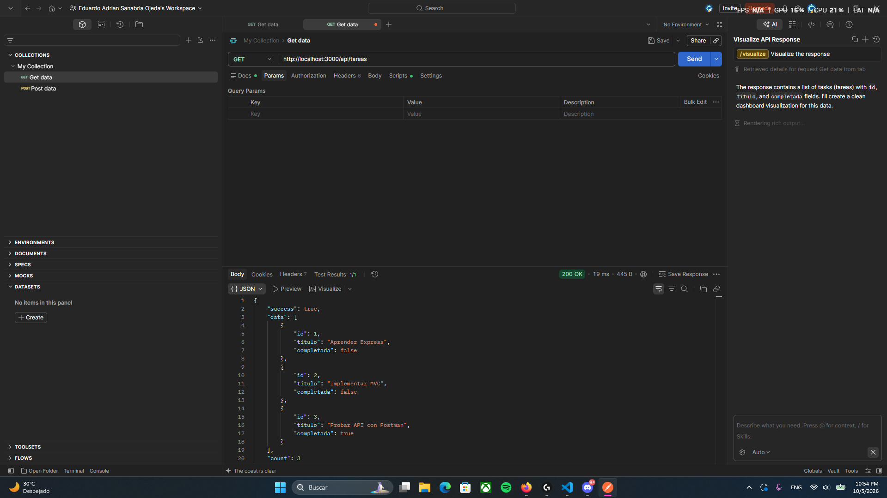
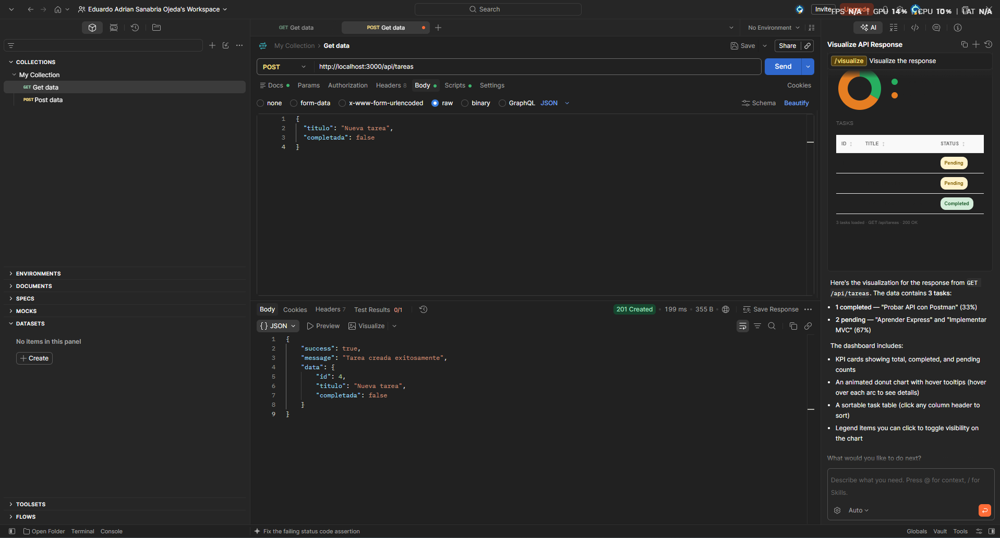
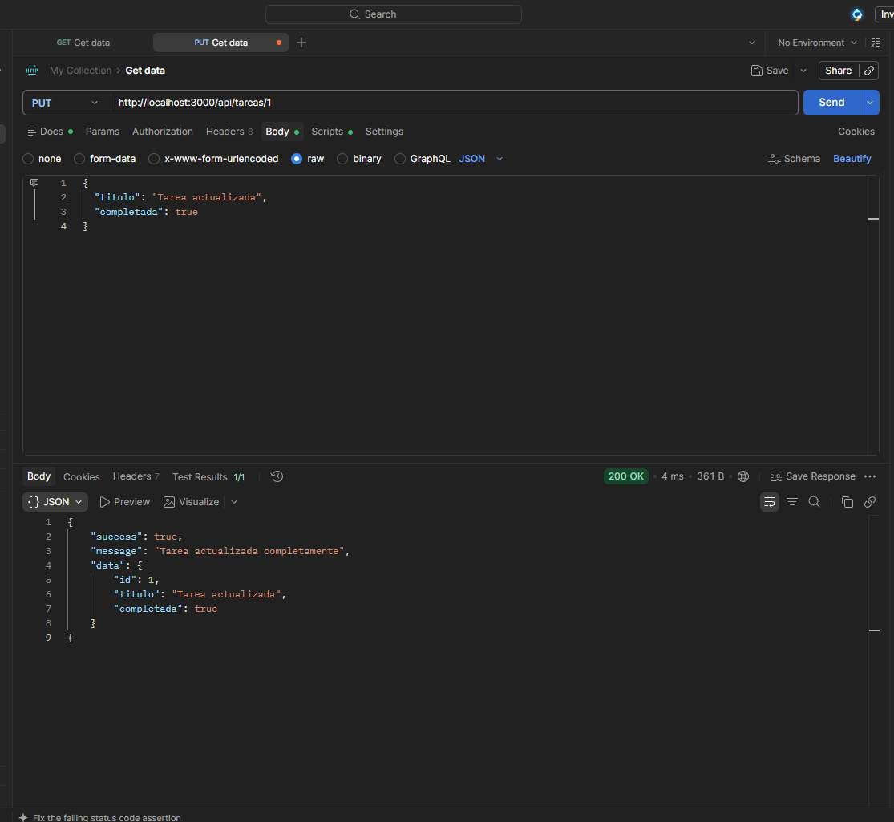
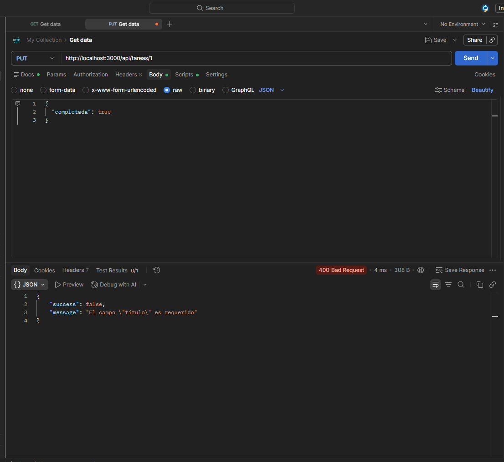
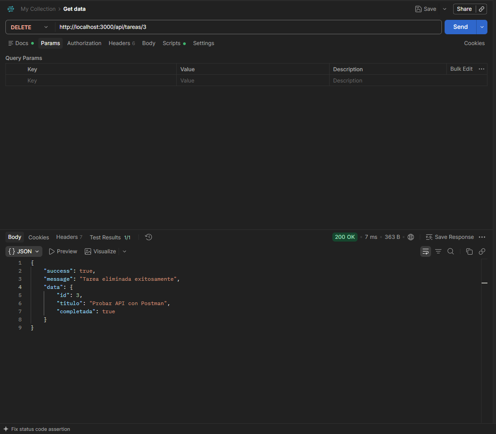

## Descripcion del proyecto:
es una API RESTful backend desarrollada en Node.js y Express, estructurada bajo el patrón  Modelo-Vista-Controlador . Su objetivo principal es ofrecer un sistema de gestión de tareas que permite realizar operaciones de creación, lectura, actualización y eliminación, además de incorporar una funcionalidad de búsqueda avanzada por título con filtros flexibles.

## Instrucciones de instalacion:
1. Clona el repositorio o descarga el proyecto.
2. Abre la terminal en la carpeta raíz del proyecto.
3. Instala las dependencias ejecutando el siguiente comando:
   pnpm install
4. ejecutar con el comando 
pnpm run dev

## Lista de endpoints disponibles

| Método | Endpoint | Descripción |
| :--- | :--- | :--- |
| **GET** | `/` | Información general de la API y bienvenida |
| **GET** | `/api/tareas` | Obtiene la lista completa de todas las tareas |
| **GET** | `/api/tareas/buscar?q=termino` | Busca tareas por título de forma parcial y case insensitive |
| **GET** | `/api/tareas/:id` | Obtiene una tarea específica filtrada por su ID |
| **POST** | `/api/tareas` | Crea una nueva tarea |
| **PUT** | `/api/tareas/:id` | Actualiza completamente una tarea existente |
| **PATCH** | `/api/tareas/:id` | Actualiza parcialmente los campos de una tarea |
| **DELETE** | `/api/tareas/:id` | Elimina una tarea por su ID |

captura

### 1. Obtener todas las tareas (`GET /api/tareas`)

### 2. Crear una nueva tarea (`POST /api/tareas`)

### 3. Actualizar una tarea completamente (`PUT /api/tareas/:id`)

### 4. Validación de campos requeridos (`PUT /api/tareas/:id` con error)

### 5. Eliminar una tarea (`DELETE /api/tareas/:id`)

## En este proyecto se utilizo el formato MVC
tareas.model:
se encarga de la logica y la gestion de los datos almacenando las tareas y definiendo las funciones para manipularlas 

tarea.controller:
es el intermediario entre el cliente y el modelo ya que esta procesa las peticiones HTTP y llama las funciones correspondientes

tarea.routes:
Configuran los endpoints de la API y los conectan con las funciones del controlador.

## Diferencia entre put y patch:
PUT esta diseñada para actualizar o remplazar por completo el recurso y PATCH esta diseñada para solo actualizar un atributo o parte de este recurso sin necesidad de remplazarlo por completo 

## A lo largo del proyecto y tal como se evidencia en las pruebas de Postman, se utilizaron los siguientes códigos de estado HTTP estándar:
200 OK: Indica que la petición se procesó con éxito. Se utiliza en peticiones GET, PUT/PATCH y DELETE.   
201 Created: Indica que la petición tuvo éxito y dio como resultado la creación de un nuevo recurso. Se utiliza exclusivamente en el endpoint POST /api/tareas al registrar una nueva tarea.   
400 Bad Request: Indica que el servidor no pudo procesar la petición debido a un error del cliente.   
404 Not Found: Se utiliza cuando se intenta buscar, actualizar o eliminar una tarea utilizando un ID que no existe en el sistema.
500 Internal Server Error: Utilizado en los bloques catch generales de los controladores para capturar y reportar cualquier fallo inesperado del servidor.